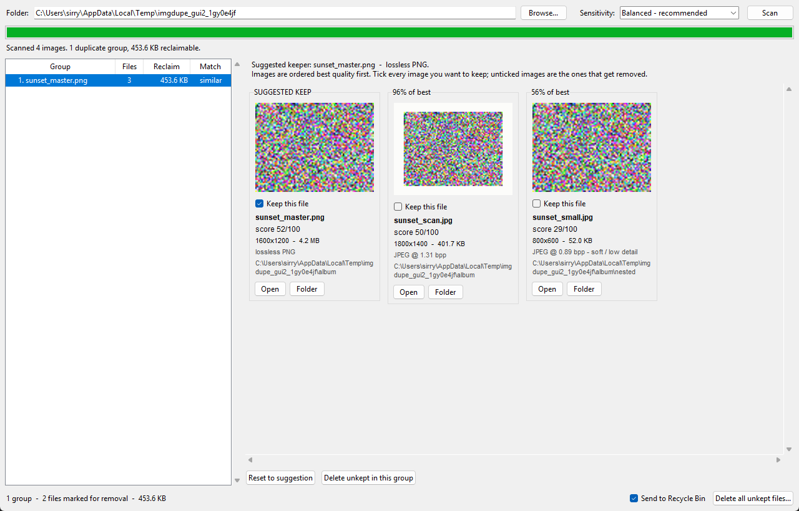

# Photo Tools

A small Windows desktop app with three tools, each on its own tab:

- **Find duplicates** — finds near-duplicate images (below).
- **Date from filename** — writes the date at the front of each file name into
  the photo's metadata, so photo apps sort it chronologically
  ([details](#date-from-filename)).
- **Rename files** — replaces a term in file names, e.g. `Bday` → `B-day`,
  without touching dates or metadata ([details](#rename-files)).

## Find duplicates

Finds near-duplicate images across a folder tree — rescans of the same picture,
re-exports at different sizes, and lossy copies of a lossless master — then ranks
each group by quality, suggests which file to keep, and removes the rest only
after you approve.



## How it works

**Matching.** Every image is reduced to two independent 64-bit perceptual hashes:

- a **pHash** built from the DCT of a 32×32 luma image, thresholded at the median
  of its low-frequency coefficients — stable across rescaling, re-compression and
  moderate brightness or colour shifts;
- a **dHash** horizontal gradient signature, which survives the heavy contrast and
  sharpening that scanners apply.

Uniform borders are trimmed before hashing, so a scan with white margins still
matches the cropped version of the same picture. Comparing every image against
every other is quadratic, so each hash is split into 16 four-bit bands and
indexed; by the pigeonhole principle two hashes within 15 bits of each other must
share a band, and only images sharing a band are ever compared in full. Matching
pairs are merged into groups with union-find.

**Ranking.** Group members are scored 0–100 on four components:

| Component | Weight | Measure |
|---|---|---|
| Resolution | 42% | megapixels, log-scaled, saturating at 24 MP |
| Sharpness | 30% | variance of the Laplacian at a fixed 512 px analysis scale |
| Encoding | 20% | lossless format, or bits per pixel for lossy ones |
| Colour | 8% | Hasler–Süsstrunk colourfulness |

Sharpness is measured at a fixed scale deliberately, so it reports real captured
detail rather than voting for resolution a second time — an upscaled blurry copy
scores low even though its pixel count is high.

**Removal.** Nothing is ever hard-deleted. Files go to the Recycle Bin, or — if
`Send2Trash` is unavailable or you untick the option — into a timestamped
`.imgdupe_quarantine` folder under the scan root that mirrors the original
directory layout. A group where you have not ticked anything to keep is always
skipped, so a whole group can never be wiped out by accident.

## Setup

```bash
python -m venv .venv
.venv\Scripts\python.exe -m pip install -r requirements.txt
```

## Running

```bash
.venv\Scripts\python.exe run.py
```

Pick a top-level folder, choose a sensitivity, and press **Scan**. Every
subfolder is searched.

- **Strict** (4 bits) — near-identical files only.
- **Balanced** (8 bits) — the default; catches resizes, re-compression and scans.
- **Loose** (14 bits) — heavier edits, at the cost of more false positives.

Select a group to review it. Members are shown best-quality-first with the
suggested keeper ticked and the reason for the suggestion spelled out. Tick every
file you want to keep; unticked files are the ones that get removed. Double-click
a thumbnail, or use **Open** / **Folder**, to inspect a file before deciding.

Then either **Delete unkept in this group** or **Delete all unkept files**, both
of which show a confirmation listing what is about to move and where.

Signatures are cached in `%LOCALAPPDATA%\imgdupe\signatures.db`, keyed by path,
size and modification time, so re-scanning a library is near instant.

## Date from filename

A GUI port of `oldTool/Set-PhotoDateFromFilename.ps1`. It reads a date prefix
from each file name — `20020128 Oma-01.JPG`, `2002-01-28 …`, `2002_01_28 …`, with
an optional time such as `20020128_134500 …` — and writes it into:

- the EXIF **Date taken** field (JPEG, TIFF, HEIC), which every photo app sorts by;
- the file's **Created** and **Modified** timestamps.

Names without a time get 12:00, or another time you choose, or you can keep the
file's existing time of day. Files are never renamed and the picture data is
never re-encoded: the EXIF write goes through the Windows Property System, the
same path File Explorer's Details tab uses, so a JPEG only grows by the ~1.4 KB
metadata block.

Press **Preview** first: it lists every image with the date it would write and
changes nothing. **Apply dates...** then writes them. Files whose name has no
date, or an impossible one such as `20020230`, are highlighted and left
untouched. The report can be saved with **Export CSV...**.

Cloud-only OneDrive placeholders cannot be written; make the folder "Always keep
on this device" first.

## Rename files

Replaces a term in file names — `20020128 Oma Bday-01.JPG` becomes
`20020128 Oma B-day-01.JPG`. Only the name changes: the file's contents, its
Created and Modified dates, EXIF and every other piece of metadata stay exactly
as they were.

Options: **Match case** (on by default), **Whole word only** (`Bday` but not
`Bdays`), **Only image files** and **Include subfolders**. The file extension is
never changed.

**Preview** lists every matching file and its new name. **Rename...** asks
before changing anything. A rename that would collide with an existing file, or
with another file in the same batch, is marked CONFLICT and skipped, so nothing
is ever overwritten. **Undo last rename** puts the original names back.

## Tests

```bash
.venv\Scripts\python.exe -m unittest discover -s tests -v
```

`test_pipeline.py` generates a synthetic library with known duplicates — a lossless
master, a downscaled lossy copy, a bordered "scan", a byte-identical pair and an
unrelated photo — and asserts that grouping, keeper selection and the cache all
behave. `test_datestamp.py` covers file-name parsing, dry runs, problem files,
file times (including pre-1970 dates) and a lossless EXIF write.
`test_renamer.py` checks the replacement rules, conflicts, undo, and that a
rename leaves contents, dates, attributes and EXIF unchanged.

## Layout

| File | Purpose |
|---|---|
| `imgdupe/scanner.py` | recursive image discovery |
| `imgdupe/hashing.py` | perceptual hashes, border trim, sharpness, colourfulness |
| `imgdupe/quality.py` | quality scoring and keeper rationale |
| `imgdupe/grouping.py` | banded candidate lookup and union-find clustering |
| `imgdupe/cache.py` | SQLite signature cache |
| `imgdupe/engine.py` | scan orchestration, threading, progress |
| `imgdupe/deleter.py` | recycle-bin and quarantine removal |
| `imgdupe/datestamp.py` | file-name date parsing, EXIF Date taken and file-time writes |
| `imgdupe/renamer.py` | find-and-replace in file names, with conflict checks and undo |
| `imgdupe/gui.py` | Tkinter interface |
